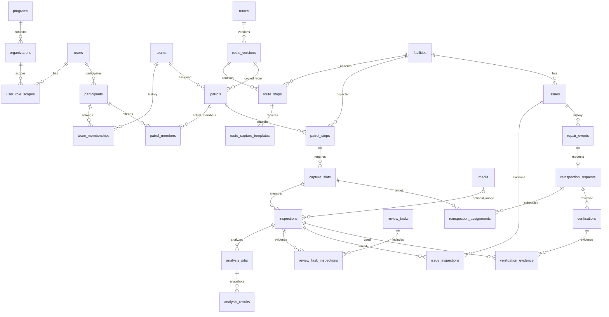

# 시니어 동네 점검단 — PostgreSQL DB 설계 v1.1

작성일: 2026-10-10. PostgreSQL 선택은 확정이며, 아래 구조는 최신 운영안과 API를 반영한 설계 제안이다. 테이블 관계와 주요 컬럼·제약조건을 정의했다. 완성된 실행용 마이그레이션이나 운영기관 승인 문서는 아니다.

AI 계약 대조 수정: [AI_연동_계약.md](AI_연동_계약.md)에 따라 저장 전 메모리 검사, 사진 없는 실패 시도, 결과 스냅샷, 현재 보수 확인 회차를 추가했다. 업무 API는 [API_명세서.md](API_명세서.md)를 따른다.

## 1. 핵심 구분

- 로그인 계정과 개인 출결은 별개다.
- 평소 조 구성과 오늘 실제 참여한 두 사람은 별개다.
- 시설, 코스의 장소, 오늘 방문 장소, 촬영 구도, 촬영 시도는 각각 다른 ID다.
- 활동 완료와 업로드·AI 분석·관리자 검토·시설 문제 종결은 별개다.
- 보수 완료 보고 후 재점검과 사람의 확인을 거쳐 사건을 닫는다.

사진은 비공개 S3에, 업무 데이터는 PostgreSQL에 저장한다. Redis에는 인증번호·Refresh Token 해시·기기별 세션 등 인증 상태를 저장한다. 서버에 도착하지 않은 사진 개수는 서버 DB에서 정확하게 알 수 없다.

## 2. 주요 관계도

그림은 주요 관계만 표시한다. 전체 테이블은 아래 목록을 따른다.

## 3. 공통 컬럼·규칙

- PK는 앱에서 생성하는 UUID `id`, FK는 `*_id`로 통일한다.
- 업무 시각은 `timestamptz`, 활동일은 한국 시간 기준 `date`다. 클라이언트 촬영 시각과 서버 수신 시각을 분리한다.
- 기본 컬럼은 `created_at`, `updated_at`. 수정 가능한 업무 테이블은 `version bigint`를 추가하고 JPA `@Version`으로 충돌을 감지한다. 추적용 이력은 추가 방식으로 기록한다.
- 상태는 `varchar + CHECK`를 기본으로 한다. Java enum과 같은 값을 사용한다.
- 업무 테이블은 `program_id`를 갖는다. 부모에 `UNIQUE(program_id,id)`를 두고 사업 간 잘못된 연결은 복합 FK로 방지한다. users는 사업 공통 계정이다.
- FK는 기본적으로 삭제 제한. 이력 있는 계정·시설·조는 비활성화한다. 사진 파일 삭제와 업무 기록 삭제는 별도 보관 정책을 적용한다.
- 전화번호는 정규화한 뒤 암호문과 검색용 HMAC으로 저장한다. 암호키는 DB 밖에서 관리한다. 비밀번호는 Spring Security의 비밀번호 해시로 저장한다.
- GPS는 위도 `numeric(9,6)`, 경도 `numeric(10,6)`와 범위 CHECK를 사용한다. 초기에는 PostGIS가 필요하지 않다.
- AI 세부 결과는 JSONB. 시설·담당 부서·확정 상태 등 핵심 업무 필드는 일반 컬럼으로 저장한다.

## 4. 계정·기관·조 — 7개

| 테이블 | 주요 컬럼 | 관계와 제약 |
|---|---|---|
| `programs` | name, status, timezone | 사업 단위. 초기에는 1행 |
| `organizations` | program_id, parent_id, type, name, status | 수행기관/담당부서/집결거점. 부모는 같은 사업. 조직 순환은 서버 검증 |
| `users` | name, phone_ciphertext, phone_lookup_hmac, login_id, password_hash, status, auth_version | 전화 HMAC과 login_id 각각 UNIQUE. 불필요한 로그인 수단은 NULL |
| `user_role_scopes` | user_id, organization_id, role, include_descendants, revoked_at | 같은 사용자·조직·역할의 유효 권한은 하나. 시니어 조회는 실제 순회 배정도 검사 |
| `participants` | user_id, organization_id, status, available_schedule_json | UNIQUE(program_id,user_id). 계정과 사업 참여 상태 분리 |
| `teams` | organization_id, name, status | 평소 조의 식별자 |
| `team_memberships` | team_id, participant_id, seat_no, valid_from, valid_until | 자리 1/2. 기간별 구성 이력. 유효기간 중 자리·참여자 중복 금지 |

역할: SENIOR / ACTIVITY_MANAGER / FACILITY_MANAGER / PROGRAM_MANAGER. 관리자 한 명에게 여러 역할을 부여할 수 있다. 사진 촬영자를 고정하는 컬럼은 만들지 않는다.

조원 기간 중복은 PostgreSQL 배타 제약 또는 조·참여자 행 잠금으로 막는다. 현재 구성만 UNIQUE로 제한하면 미래 배정 기간 중복을 막을 수 없으므로 기간 전체를 검사한다. 전화 공유를 허용하려면 번호 기반 로그인 식별 정책을 다시 정해야 한다.

## 5. 시설·코스 — 5개

| 테이블 | 주요 컬럼 | 관계와 제약 |
|---|---|---|
| `facilities` | facility_code, type, name, latitude, longitude, area_label, managing_department_id, status | UNIQUE(program_id,facility_code). 긴 보도·펜스는 점검 가능한 구간 단위 |
| `routes` | organization_id, name, status | 코스 식별자 |
| `route_versions` | route_id, version_no, departure_base_id, return_base_id, published_at | UNIQUE(route_id,version_no). 공개·배정된 내용은 수정 대신 새 버전 |
| `route_stops` | route_version_id, facility_id, sequence_no, instruction | UNIQUE(route_version_id,sequence_no). 같은 시설의 재방문 허용 |
| `route_capture_templates` | route_stop_id, sequence_no, label, instruction, reference_media_id, required | 장소별 필요한 촬영 구도. UNIQUE(route_stop_id,sequence_no) |

시설 종류: SIDEWALK / DRAIN / BENCH / SAFETY_FENCE / EXERCISE_EQUIPMENT.

시설 관리 부서는 시설 대장을 기준으로 한다. AI 분류 결과로 소유 부서를 덮어쓰지 않는다. 과거 순회에는 당시 담당 부서 스냅샷을 남기고, 진행 중 사건의 현재 담당은 issues에서 따로 관리한다.

## 6. 날짜별 순회·출결 — 5개

| 테이블 | 주요 컬럼 | 관계와 제약 |
|---|---|---|
| `patrols` | team_id, route_version_id, organization_id, activity_date, scheduled_start_at, expected_return_at, route_name_snapshot, activity_status, return_reason, departed_at, departure_confirmed_by, finished_at, sync_deadline_at, revision | 조 단위의 오늘 활동. 예정 종료 > 시작. 같은 날 여러 회차 가능 |
| `patrol_members` | patrol_id, participant_id, seat_no, attendance, attendance_checked_by/at, returned_at, return_confirmed_by | UNIQUE(patrol_id,participant_id), UNIQUE(patrol_id,seat_no). 개인별 출석·복귀 |
| `patrol_stops` | patrol_id, source_route_stop_id, facility_id, sequence_no, name/type/location/instruction/department_snapshot, visit_status | 배정 당시 장소 복사. UNIQUE(patrol_id,sequence_no) |
| `capture_slots` | patrol_stop_id, source_template_id, sequence_no, label, instruction, reference_media_id, required, purpose, accepted_inspection_id, active_inspection_id, quality_failure_count, resolution | 오늘 필요한 한 구도. UNIQUE(patrol_stop_id,sequence_no). purpose=REGULAR/REINSPECTION. resolution=OPEN/ACCEPTED/REVIEW_REQUESTED/SKIPPED |
| `patrol_events` | patrol_id, patrol_stop_id, actor_user_id, client_event_id, request_hash, type, reason_code, occurred_at, received_at, payload_json | 쉬기/건너뛰기/복귀 요청/연락/예외 이력. UNIQUE(actor_user_id,client_event_id). 같은 ID의 다른 내용은 409 |

**출발 시 두 명 보장:** CHECK만으로 자식 행 2개를 보장할 수 없다. 출발 트랜잭션에서 순회와 참여자 행을 잠그고 실제 출석 2명·유효 자격·다른 순회와 시간 중복 없음을 검사한다. 배정·일정 수정 API도 동일한 잠금 규칙을 사용한다.

출발 전 결원 교체는 patrol_members를 변경하고 audit에 이전 구성을 기록한다. 출발 후에는 일반 구성·코스 수정을 금지한다. 평소 조를 수정해도 과거 순회의 두 사람은 바뀌지 않는다.

상태:

- 활동: ASSIGNED → IN_PROGRESS → RETURNING → COMPLETED. 중도 종료는 RETURNING 이후 ABORTED. 출발 전 취소는 CANCELLED.
- 장소: PENDING / CAPTURED / SKIPPED / REVIEW_REQUESTED / NOT_VISITED.
- 건너뛰기 이유: UNSAFE / NOT_FOUND / OTHER. 자유 입력은 요구하지 않는다.

두 사람 복귀를 각각 확인해야 활동이 완료된다. 사진 전송·분석 대기는 복귀 확인을 막지 않는다. 늦게 도착한 사진 때문에 완료된 활동을 진행 중으로 되돌리지 않는다. 건너뛰기와 미방문 사실은 이벤트 이력으로 보존한다.

## 7. 사진·분석 — 4개

| 테이블 | 주요 컬럼 | 관계와 제약 |
|---|---|---|
| `media` | uploaded_by, bucket, object_key, purpose, privacy_status, source_media_id, content_type, size_bytes, sha256, provider_photo_id, provider_image_revision, privacy_report_json, deleted_at | UNIQUE(bucket,object_key). 재마스킹은 새 객체·새 행. AI 사진 식별자/버전은 선택. 임시 URL 저장 금지 |
| `inspections` | capture_slot_id, submitted_by, client_submission_id, request_hash, submission_sha256, attempt_id, attempt_no, media_id, approved_media_id, captured_at, submitted_at, received_at, receipt_status, ingestion_lease_token/until, masking_version, device_masked, device_mask_report_json, capture_status, latitude/longitude/accuracy | UNIQUE(submitted_by,client_submission_id), UNIQUE(submitted_by,attempt_id), UNIQUE(capture_slot_id,attempt_no). 예약·사진 없는 실패는 media_id/approved_media_id/received_at=NULL. 운영 device_masked=true 필수 |
| `analysis_jobs` | inspection_id, verification_id, media_id, type, status, retry_owner, provider_photo_id, input_hash, attempt_count, next_run_at, locked_until, lease_token, model_version, input_version, error_code, started_at, finished_at | ANALYZE/QUALITY/DEFECT는 inspection, COMPARISON은 verification, PRIVACY는 media. 대상은 정확히 하나. 대상별 부분 UNIQUE로 대상/type/input_version 중복 금지. provider_photo_id는 외부 호출 ID |
| `analysis_results` | analysis_job_id, snapshot_no, provider_result_version, result_hash, result_json, model_version, prompt_version, contract_version, observed_at, image_media_id | 추가 방식. UNIQUE(analysis_job_id,snapshot_no). 현재와 같은 결과 해시는 재추가하지 않음. 사람 판단이 참조한 스냅샷 고정. JSON에서 사진 URL·비밀 값 제거 |

media 목적: INSPECTION / REFERENCE / REPAIR_EVIDENCE. 개인정보 상태: QUARANTINED / APPROVED / REJECTED. 서버 최초 검사 전 사진은 메모리에서만 처리하고 S3·디스크에 저장하지 않는다. QUARANTINED는 이미 검사된 저장본의 추가 검토/재검사 보류용이다. 승인 사진만 조회·시설 판독에 사용한다. approved_media_id가 원래 검사된 media 또는 source_media_id 계보의 파생본인지 같은 사업·출처까지 검증한다.

참고 사진·보수 증거는 사진 판독 실적을 만들지 않는 개인정보 단독 검사 경로가 필요하다. 현재 AI에 그 API가 없으므로 일반 업로드는 연동 전 비활성화한다. 최초 저장 전 검사는 동기 경로이고, analysis_jobs.PRIVACY는 저장된 모든 종류의 media 재검사용이다. 존재하지 않는 업로드 바이트를 DB 작업만으로 복구한다고 가정하지 않는다.

AI에 현재 있는 /analyze는 ANALYZE 작업 하나로 통합 호출한다. 내부 품질·이상 결과를 분리 저장할 수 있지만 동일 사진을 QUALITY/DEFECT 별도 외부 호출로 중복 처리하지 않는다. retry_owner=BACKEND/AI로 재시도 책임을 구분하고, AI 재판독은 /results 추적으로 결과 스냅샷을 추가한다. provider_photo_id는 외부 작업별 UUID이며 comparison은 analyze와 다른 ID를 쓴다. 같은 외부 ID의 입력 해시는 변경 금지다. 아직 없는 provider_result_version은 NULL로 두고 수신 순서를 직렬화한다. 결과와 이미지 버전을 원자적으로 묶는 운영 계약은 AI 측 보완이 필요하다.

receipt_status: RECEIVING / RECEIVED / NO_MEDIA / RETRY_REQUIRED. RECEIVED는 media_id·received_at 필수, 나머지 접수 상태에서는 media_id·approved_media_id·received_at이 모두 NULL이다. 최초 제출 파일 해시와 요청 해시는 이미지가 없어도 남긴다. 최초 RECEIVED 전환은 승인 사진이 있어야 한다. 이후 개인정보 보류/거절 시 receipt_status는 과거 영속 접수 사실을 유지하고 현재 조회는 media.privacy_status로 차단한다. 이때 approved_media_id·구도 채택 포인터를 해제하고 capture_status/resolution을 REVIEW_REQUESTED로 바꾸어 재검토한다. 과거 채택·활동 이력은 보존한다.

사진 상태: PROCESSING / ACCEPTED / RETAKE_REQUIRED / TECHNICAL_FAILED / REVIEW_REQUESTED. AI 작업 상태: PENDING / PROCESSING / SUCCEEDED / FAILED.

### 두 사람의 동시 제출과 재촬영

1. 로그인 사용자와 실제 순회 배정·동기화 허용 기간을 검증한다.
2. 동일 제출 ID는 대상·파일·메타데이터 해시가 같을 때 기존 접수 결과를 반환한다. 내용이 다르면 409. 예약 중이면 SUBMISSION_PROCESSING, 재전송 필요면 동일 시도의 예약을 재획득한다.
3. capture_slots 행을 잠근다. 이미 채택 사진이 있으면 기존 접수 결과를 반환하고 중복 집계하지 않는다.
4. 먼저 처리 중인 사진이 있으면 409 SLOT_PROCESSING과 기존 inspectionId를 반환한다. 상대 폰은 사진을 보관하며 결과를 기다린다.
5. 선행 사진이 품질 실패하면 새 attempt로 제출할 수 있다. 채택 성공 확인 전에는 상대 폰 사진을 삭제하지 않는다.
6. 채택 시 accepted_inspection_id와 resolution=ACCEPTED를 설정하고 active를 해제한다. 품질 실패도 active를 해제한다. 기술 재시도는 구도 잠금 아래 active를 재획득하고 이미 다른 시도가 채택되었으면 중단한다. 오래된 AI 작업은 작업 세대·리스 토큰·현재 대상을 검증해 무효화한다. 외부 호출 중 잠금을 유지하지 않는다.

accepted/active는 `(inspection_id,slot_id)` 복합 FK로 같은 구도의 사진만 참조한다. 채택 상태·마스킹 승인 여부는 FK만으로 보장할 수 없어 서비스 트랜잭션에서 검증한다.

실행 검증 보완: `inspections(capture_slot_id) WHERE capture_status='ACCEPTED'` 부분 UNIQUE 인덱스로 구도당 채택 상태의 사진도 하나로 제한한다. 구도의 accepted 포인터만으로는 다른 inspection 행까지 ACCEPTED로 기록되는 오류를 막지 못한다. 개인정보 승인·현재 포인터 일치는 여전히 서비스 트랜잭션에서 확인한다.

재전송은 동일 ID, 실제 재촬영은 새 ID다. 서버 기술 재처리는 같은 inspection에서 작업을 재시도한다. 수정안의 상한은 구도별 최초+재촬영2회이며 품질 실패만 반영한다. 실패 수 증가는 각 시도별 한 번만 원자적으로 적용한다. 3번째 품질 실패 또는 사람 확인 인계는 resolution=REVIEW_REQUESTED다. 모든 필수 구도가 ACCEPTED/REVIEW_REQUESTED이면 진행하고, 필수 구도 모두 채택 시 장소 CAPTURED, 검토 인계가 있으면 REVIEW_REQUESTED다. 선행 실패 후 미접수 상대 폰 사진을 새 시도로 쓸 수 있다. attemptId와 clientSubmissionId는 계약대로 보존한다.

S3와 DB는 하나의 트랜잭션이 아니다. DB 예약(사진 없음) → 메모리에서 AI 통합 호출·검사 완료 사진 확보 → 승인본 S3 저장 → DB 결과·작업 커밋 → 접수 응답 순서다. retake에 저장 사진이 없으면 NO_MEDIA와 실패 이력만 커밋한다. 중간 장애는 접수 리스·동일 AI ID 결과 조회로 복구하고, 사진 복구 불가이면 RETRY_REQUIRED로 앱 재전송을 요구한다. 고아 S3 파일은 정리한다. Redis 알림 유실은 DB 작업에서 복구한다. AI의 재마스킹·보류를 S3 복사본까지 반영하는 계약은 운영 전 필수다.

## 8. 관리자 검토·시설 문제 — 5개

| 테이블 | 주요 컬럼 | 관계와 제약 |
|---|---|---|
| `review_tasks` | facility_id, patrol_stop_id, reinspection_request_id, type, status, priority, trigger_key, assigned_department_id, claimed_by | INSPECTION/CAPTURE_FAILURE/REPAIR_VERIFICATION. UNIQUE(program_id,trigger_key)로 동일 원인 재전달 중복 방지. priority=NORMAL/URGENT. 사진 없는 실패도 가능 |
| `review_task_inspections` | review_task_id, inspection_id | 조합 UNIQUE. 같은 시설인지 검증 |
| `review_decisions` | review_task_id, analysis_result_id, decided_by, decision, follow_up_type, reason, decided_at | 판단 이력 추가. 참조 AI snapshot은 선택. 사진 없는 실패는 FOLLOW_UP_REQUIRED/RESOLVE_CAPTURE_PROBLEM만 허용 |
| `issues` | facility_id, defect_code, summary, status, assigned_department_id, source_review_decision_id, previous_issue_id, current_reinspection_request_id, opened_at, closed_at | 사람 확인으로 생성. defect_code는 시설 종류와 AI taxonomy 조합 매핑. 재발은 새 사건+이전 사건 연결. 현재 보수 확인 요청을 명시 |
| `issue_inspections` | issue_id, inspection_id, linked_by/at, unlinked_by/at, reason | 사진↔사건 다대다. 유효 연결만 조합 부분 UNIQUE, 해제 이력 보존 |

한 사진에 여러 문제, 한 문제에 여러 날짜의 사진을 연결할 수 있다. AI 의심 결과와 사람 확정은 분리한다. 이상 미발견 표본 비율은 운영 설정이다.

같은 시설·같은 미해결 문제는 기존 사건에 추가한다. 다만 같은 이상 코드라도 다른 부위의 문제일 수 있으므로 시설+코드의 일률 UNIQUE는 두지 않는다. 시설 행을 잠그고 기존 후보를 확인한 후 담당자가 연결/신규를 선택한다. 의미상 중복을 DB만으로 모두 판정할 수는 없다.

## 9. 보수·재점검·수리 확인 — 7개

| 테이블 | 주요 컬럼 | 관계와 제약 |
|---|---|---|
| `repair_events` | issue_id, type, actor_user_id, department_id, description, occurred_at, recorded_at | REQUESTED/STARTED/COMPLETED/RE_REQUESTED 이력 추가 |
| `repair_event_media` | repair_event_id, media_id | 조합 UNIQUE. 보수 완료 첨부 사진 |
| `reinspection_requests` | facility_id, issue_id, repair_event_id, review_decision_id, request_type, status, requested_by, due_at | REPHOTO/SITE_VISIT. 발생 원인은 보수 완료 또는 추가 확인 판정 중 하나. 각각 UNIQUE |
| `reinspection_assignments` | request_id, capture_slot_id, assigned_by/at, cancelled_at, completed_at | 요청을 REINSPECTION 구도에 연결. cancelled_at과 completed_at 모두 NULL인 활성 조합 부분 UNIQUE. 같은 요청의 활성 구도는 한 순회 안에서만 허용. 출발 전 재배정은 취소+추가, 출발한 배정은 완료 이력 후 새 순회에 추가 |
| `verifications` | request_id, analysis_result_id, decided_by, decision, follow_up_type, reason, verification_method, verified_at | CLOSE/REPAIR_AGAIN/FOLLOW_UP_REQUIRED, PHOTO/SITE_VISIT. 요청별 판단 이력·참조 AI snapshot 보존 |
| `verification_evidence` | verification_id, inspection_id, role | BEFORE/AFTER 사진 연결. 조합 UNIQUE |
| `verification_notes` | verification_id, author_user_id, note, created_at | 현장 확인·추가 확인 과정의 근거 기록. 최종 판단은 verifications |

제공 AI의 /verify를 COMPARISON 작업으로 연동할 수 있게 설계한다. AI 결과는 수리 확인 제안이며 최종 종결·재보수는 사람이 결정한다. 비교 기능 사용 여부와 시연 포함 범위는 별도 설정한다. 비교 실패 시 근거를 갖춘 사람 확인은 가능하다.

보수 완료 이벤트 + 사건 AWAITING_VERIFICATION + 재점검 요청 생성 + current_reinspection_request_id 갱신은 같은 트랜잭션이다. repair_event_id로 보수 회차를 고정한다. issues의 현재 요청은 (program_id,current_reinspection_request_id,id) → reinspection_requests(program_id,id,issue_id) 복합 FK로 같은 사건을 참조한다. 요청의 repair_event는 해당 사건의 COMPLETED여야 하며 검토 기원과 배타적으로 존재한다. UNIQUE 제약과 NULL 배타 CHECK를 DDL에 구현한다. 재보수해도 이전 비교·판단을 덮어쓰지 않는다.

확인 중 verifications는 decision/verified_at이 NULL인 준비 상태가 가능하다. 최종 판단 시 담당자·결정·시각을 함께 기록하고 변경 이력을 남긴다. 별도 현장 확인은 사진이 없어도 근거 필수. CLOSE는 해당 사건의 보수 확인에서만 허용한다.

준비 상태는 decided_by/decision/verified_at 모두 NULL, 확정 상태는 모두 NOT NULL이다. 확정 행은 수정하지 않고 후속 판단을 추가한다. 최종 판정은 사건·요청·verification 잠금 및 버전 검증 아래 현재 요청·열린 요청·AWAITING_VERIFICATION 여부까지 검사한다. 오래된 보수 회차는 STALE_VERIFICATION으로 거절한다. PHOTO 증거는 같은 시설의 BEFORE와 현재 요청의 유효 배정 구도에서 채택한 AFTER여야 한다. SITE_VISIT는 verification_notes 근거가 필수다. FOLLOW_UP_REQUIRED는 같은 보수 요청을 유지하면서 배정을 갱신하며 새 보수 완료 요청을 중복 생성하지 않는다.

사건: OPEN → REPAIR_REQUESTED → IN_REPAIR → AWAITING_VERIFICATION → CLOSED. 재보수 요청이면 REPAIR_REQUESTED로 돌아가고 이력을 추가한다. 배정 시 요청 시설과 순회 장소 시설의 일치도 검증한다.

## 10. 공통 운영 — 5개

| 테이블 | 주요 컬럼 | 관계와 제약 |
|---|---|---|
| `idempotency_requests` | user_id, operation, idempotency_key, request_hash, state, response_code, resource_id, expires_at | UNIQUE(user_id,operation,idempotency_key). 업무 변경과 같은 트랜잭션. 민감 응답은 저장하지 않고 재구성 |
| `audit_events` | actor_user_id, action, resource_type/id, reason, before_json, after_json, request_id, created_at | 변경 감사. 토큰·전화 평문·사진 URL 제외. 범용 대상 ID는 FK가 아니므로 앱에서 검증 |
| `outbox_events` | event_type, aggregate_id, payload_json, status, next_run_at, attempts | 커밋 후 작업·알림 발행. 중복 전달 가능하므로 수신자도 멱등 처리 |
| `notifications` | user_id, type, resource_type/id, message, read_at | 관리자 알림. 조회 시에도 권한 검사 |
| `report_jobs` | organization_id, week_start, status, requested_by, metrics_json, narrative, generated_at, source_cutoff_at, revision_no | UNIQUE(organization_id,week_start,revision_no). 서버 집계값과 AI 문장을 분리 |

총 **38개 테이블**이다. AI 결과 스냅샷 1개를 추가했다. 알림·보고·확인 메모 등은 후순위이며 한꺼번에 모두 구현할 필요는 없다.

## 11. 인덱스와 서비스 검증

- FK 자식 컬럼의 검색 인덱스는 직접 생성한다. UNIQUE 인덱스가 같은 선두 컬럼을 포함하면 중복 생성하지 않는다.
- 당일 목록: patrols(program_id,activity_date,organization_id,activity_status).
- 개인 배정: patrol_members(participant_id,patrol_id).
- 재촬영 이력: inspections(capture_slot_id,received_at DESC).
- 작업 실행: analysis_jobs(status,next_run_at), 미완료 작업 부분 인덱스. 워커는 SKIP LOCKED와 만료 가능한 리스를 사용한다.
- 입력 복구: inspections(receipt_status,ingestion_lease_until), 수신 중/재전송 필요 부분 인덱스. AI 결과: analysis_results(analysis_job_id,snapshot_no DESC).
- 검토 목록: review_tasks(program_id,assigned_department_id,status,created_at).
- 담당 사건: issues(program_id,assigned_department_id,status,opened_at), 시설 이력: issues(facility_id,status).
- 재점검: reinspection_requests(program_id,status,due_at).
- 감사: audit_events(program_id,resource_type,resource_id,created_at).
- JSONB 인덱스는 실제 검색 요구가 생긴 필드에만 추가한다.

조직 유형, 관할 권한, 동일 시설 여부, 출발 가능 조건, 상태 전이, 마스킹 승인 후 채택은 FK만으로 전부 보장되지 않는다. 서비스 검증과 트랜잭션이 필요하다. 여러 참여자를 잠글 때는 ID 순서를 통일한다.

### 트랜잭션 잠금 순서 — 실행 검증 보완

- 기본 격리는 READ COMMITTED. 검사와 변경은 같은 트랜잭션에서 수행하고, 잠금 대기 후 최신 값을 다시 확인한다. JPA 캐시의 오래된 엔티티를 검증에 재사용하지 않도록 실제 구현을 확인한다.
- 사진 접수/결과·건너뛰기·복귀 등 순회 흐름은 **patrols → capture_slots → inspections → media** 순서로 필요한 행을 잠근다. 여러 행은 각 단계에서 UUID 오름차순. 구도를 먼저 잠근 뒤 순회 revision을 갱신하는 순서는 사용하지 않는다.
- 출발·출결·조원/일정 수정은 **대상 patrols(ID순) → participants(ID순) → patrol_members** 순서다. 출발은 두 명 출석·유효 참여 상태·진행 중 중복을 검사하고, 배정/일정 수정은 예정 배정의 겹침도 검사한다. 모든 수정 경로가 동일 규칙을 따라야 한다.
- 사건 처리·최종 판단은 **issues → reinspection_requests → verifications** 순서다. 현재 요청·보수 회차·버전을 검사한 후 사건/요청/판정/outbox를 함께 커밋한다. 요청만 잠그고 사건을 나중에 잡는 역순을 피한다.
- 요청과 순회를 함께 다루는 재배정은 **issues(사건이 있으면) → reinspection_requests → patrols → capture_slots**로 고정한다. 사진 워커는 순회 잠금을 유지한 채 요청/사건을 역순으로 잠그지 않는다. 필요 후속 업무는 같은 커밋의 outbox 이후 별도 트랜잭션에서 처리한다.
- 작업 lease 확보는 짧은 별도 트랜잭션으로 종료한다. 외부 작업 후 상태 적용은 위 업무 잠금 순서를 따르고 작업 세대/lease token을 검증한다. 외부 호출 중 DB 잠금을 유지하지 않는다.
- 40P01 교착 또는 40001 직렬화 실패가 발생하면 실패한 트랜잭션 전체를 롤백하고 같은 멱등 키로 제한 재시도한다. 입력 충돌·과거 보수 회차·이미 끝난 구도는 재시도해 우회하지 않는다.

## 12. 구현 순서

1. 계정·기관·참여자와 시연용 사전 등록 데이터.
2. 시설·조·코스·오늘 순회 배정.
3. 출발·촬영·다음 장소·개인별 복귀까지 연결.
4. 관리자 확인·사건 등록.
5. 보수·재점검·사람의 수리 확인.
6. 보고·알림·고급 운영 편집.

10월 15일 시연은 **로그인 → 오늘 조별 순회 → 담당자 출발 확인 → 사진 접수/품질 → 다음 장소 → 복귀 확인 → 관리자 사진 확인**부터 완성한다. 모든 테이블의 관리 화면 완성을 시연 조건으로 잡지 않는다.

Flyway로 마이그레이션하고 실행 환경에서는 ddl-auto=validate를 사용한다. 개발·시연 시드는 실제 서비스 데이터와 분리한다. [핵심 SQL 초안](database/core-schema-draft.sql)은 촬영 구도·동시 접수·사진 없는 시도 제약을 설명하는 독립 예제이며, 전체 38개 테이블의 실행용 DDL은 아니다.

## 13. 남은 운영 설정과 검증 범위

구조와 API의 대조 수정안을 정리했다. 실제 AI 연동과 실행 검증은 남아 있으며 구현 전 아래 값을 확정한다.

- 오프라인 동기화 허용 기간과 초과 접수 처리.
- 구도별 총 3회·미접수 상대 폰 대기 사진 활용 정책의 현장 검증.
- AI 개인정보 단독 처리, 이미지 버전/보류 전파, 영속 멱등 처리와 실제 fixtures 검증.
- 시설별 촬영 장수, AI 계약, 사진 용량·보관 기간.
- 개인정보·감사·활동 이력 보관 기간과 전화번호 변경/재할당 절차.
- 관리자 MFA 방식. TOTP 등을 사용한다면 암호화 인증정보 테이블을 별도 추가한다.

2026-10-10 트랜잭션 실행 검증을 추가했다. [검증 구성·재현 방법](database/transaction-tests/README.md)과 [실행 결과](database/transaction-tests/results.json)를 따른다. 기존 7개 테이블과 검증용 축약 7개 테이블에서 독립 PostgreSQL 연결로 핵심 경쟁 조건·롤백을 검사한다. 전체 38개 테이블과 실제 Spring/JPA 구현을 검증한 것은 아니다.
