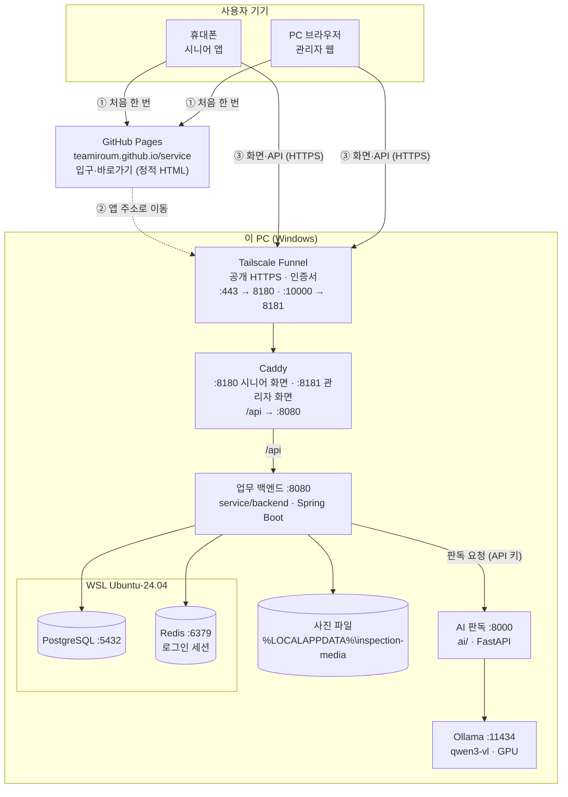
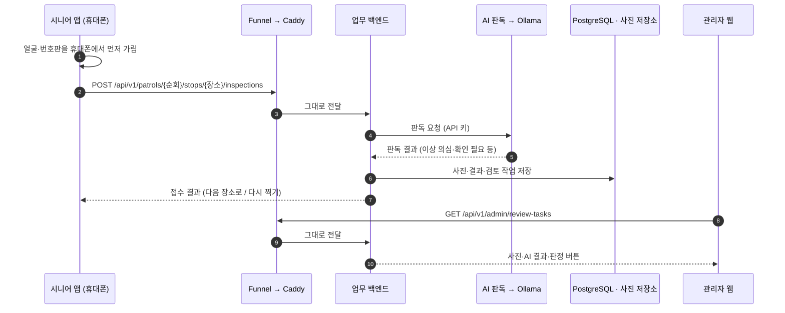

# 서비스 구성 (이 PC 한 대로 운영)

시니어 앱·관리자 웹은 깃페이지 주소로 들어오고, 실제 화면·업무 API·DB·AI는 모두 이 PC에서 돈다. 2026-10-14 기준.

## 한눈에 보기

- GitHub Pages는 **처음에 앱 주소로 넘겨 주기만** 한다. 넘어간 뒤의 요청은 GitHub를 거치지 않는다
- 화면과 업무 API가 **같은 주소**(`*.ts.net`)라 로그인 쿠키(`__Host-`)와 CSRF 보호가 그대로 동작한다
- AI 판독 서버는 업무 백엔드만 부른다. 앱·관리자 웹은 AI를 직접 부르지 않는다

## 주소

| 화면 | 깃페이지 (입구·QR) | 앱 주소 |
|---|---|---|
| 입구 | https://teamiroum.github.io/service/ | — |
| 시니어 앱 | https://teamiroum.github.io/service/senior | https://desktop-iv9p5jl.tail3f4b5a.ts.net |
| 관리자 웹 | https://teamiroum.github.io/service/admin | https://desktop-iv9p5jl.tail3f4b5a.ts.net:10000 |

## 구성 요소

| 구성 요소 | 위치 | 포트 | 하는 일 |
|---|---|---|---|
| GitHub Pages | `TeamIroum/service` 저장소 | 443 | 입구 페이지, `/senior`·`/admin` 바로가기 (`web/pages/deploy_pages.py`로 올림) |
| Tailscale Funnel | 이 PC | 443, 10000 | 인터넷에서 오는 HTTPS를 받아 이 PC 안의 Caddy로 넘김. 인증서 자동 |
| Caddy | `service/web/Caddyfile` | 8180, 8181 (127.0.0.1) | 빌드된 화면 파일 제공, `/api`를 백엔드로 넘김 (접속 포트를 `X-Forwarded-Port`로 전달) |
| 시니어 앱 | `service/senior` (React + Vite) | — | 로그인, 출석, 촬영(휴대폰에서 얼굴·번호판 먼저 가림), 건너뛰기, 쉬기, 복귀 |
| 관리자 웹 | `service/admin` (React + Vite) | — | 오늘 활동 현황, 검토·판정, 사건·보수 |
| 업무 백엔드 | `service/backend` (Spring Boot, local 프로필) | 8080 (127.0.0.1) | 업무 API, 시연 데이터, AI 호출, 사진 저장 |
| PostgreSQL | WSL Ubuntu-24.04 | 5432 | 업무 데이터 |
| Redis | WSL Ubuntu-24.04 | 6379 | 로그인 세션, 인증번호 시도 기록 |
| 사진 저장소 | `%LOCALAPPDATA%\inspection-media` | — | 가린 뒤 접수된 사진 (DB에는 위치만) |
| AI 판독 | `ai/` (FastAPI) | 8000 (127.0.0.1) | 사진 판독, 개인정보 검사, 변경 알림 |
| Ollama | 이 PC | 11434 | 판독 모델 qwen3-vl (GPU) |

## 요청 흐름: 시니어가 사진을 보낼 때

## 어디가 꺼지면

| 꺼진 곳 | 증상 | 대처 |
|---|---|---|
| GitHub Pages | 깃페이지 주소만 안 열림 | 앱 주소(`ts.net`)로 직접 접속 |
| 이 PC 전원·인터넷, Funnel, Caddy | 앱 전체가 안 열림 | `start.ps1` |
| 업무 백엔드 | 화면은 열리지만 로그인부터 안 됨 | `start.ps1` |
| WSL (PostgreSQL·Redis) | 로그인·조회 오류 | `wsl --shutdown` 뒤 `start.ps1` (start.ps1이 WSL을 계속 켜 둠) |
| AI 판독·Ollama | 사진은 접수되지만 판독이 안 됨 | `start.ps1`, Ollama 실행 확인 |

켜기·끄기: `powershell -ExecutionPolicy Bypass -File service/start.ps1` · `service/stop.ps1`

## 원래 기획(AWS)과의 관계

기획 구조(WEB → WAS → RDS, S3, AI 서버 분리)를 이 PC 한 대에 옮긴 형태다. 서버를 AWS로 옮길 때는 같은 역할을 이렇게 바꾼다.

| 이 PC | AWS로 옮길 때 |
|---|---|
| Funnel + Caddy | WEB EC2 (nginx, `infra/aws/web/nginx.conf`) |
| 업무 백엔드 + Redis | WAS EC2 (`service/docker/`의 Dockerfile·compose) |
| PostgreSQL (WSL) | RDS PostgreSQL |
| 사진 저장소 (파일) | S3 (`MEDIA_STORE=s3`, 백엔드에 구현돼 있음) |
| AI 판독 + Ollama | 분리된 AI 서버 (GPU) |
